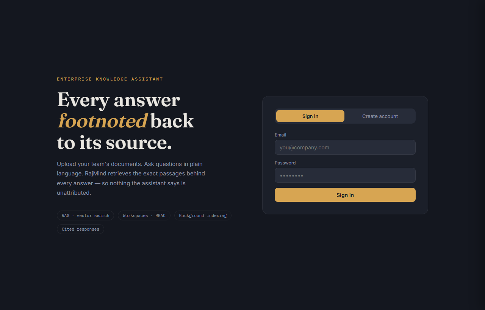
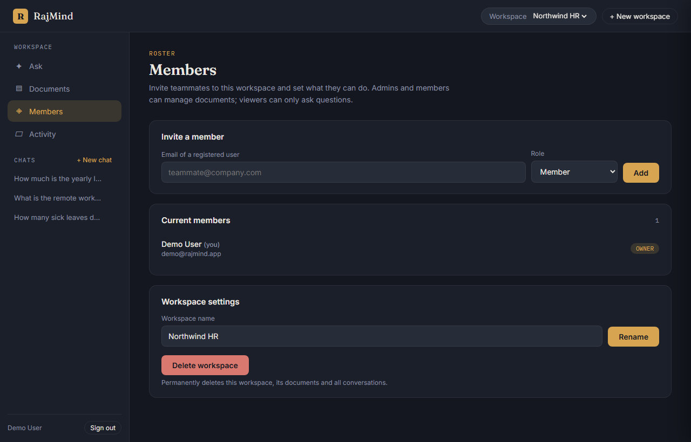
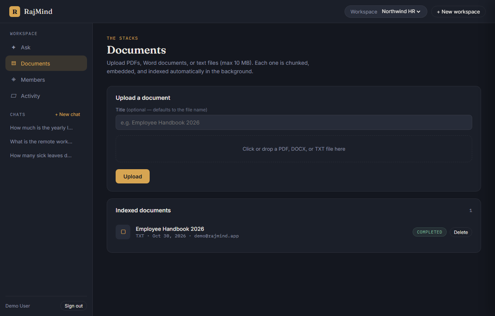
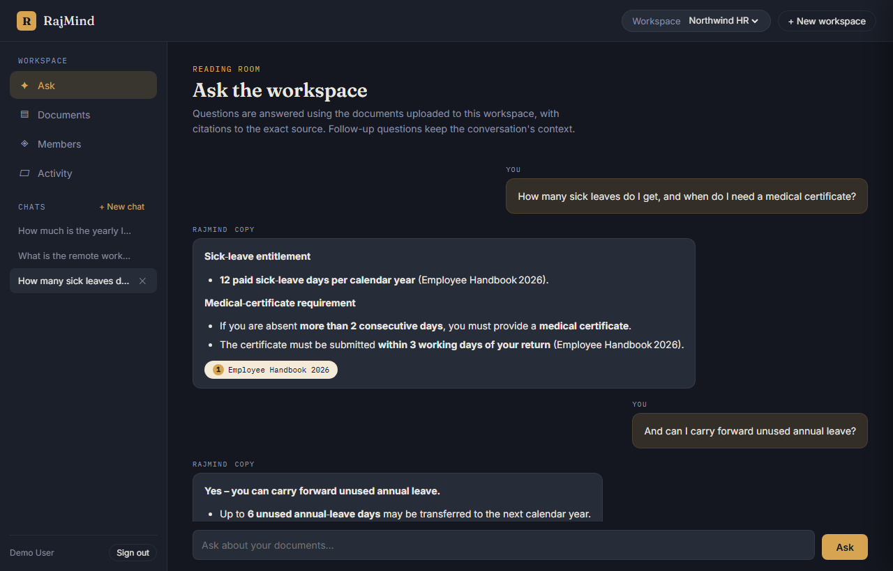
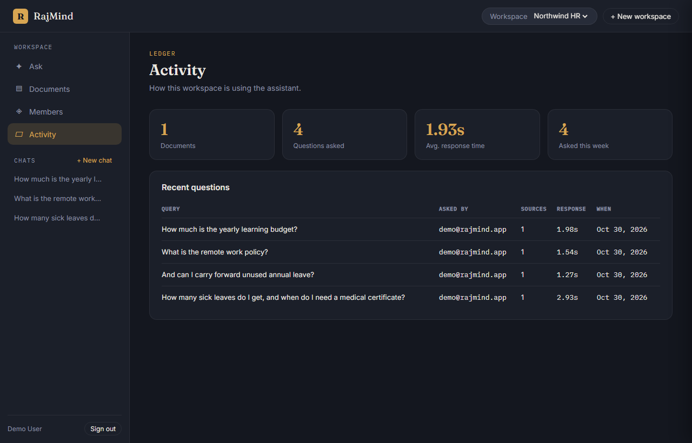

# RajMind – Enterprise AI Knowledge Assistant

A multi-tenant AI-powered knowledge platform that enables organizations to centralize company documents and retrieve information using natural language queries with source-backed answers.

---

## Problem Statement

Organizations store critical information across PDFs, SOPs, HR policies, technical documentation, onboarding guides, project reports, and internal knowledge bases.

Finding the right information often requires employees to manually search through multiple documents, resulting in wasted time and reduced productivity.

RajMind solves this problem by transforming company documents into a searchable AI knowledge system that allows users to ask questions in plain English and receive accurate answers with citations from the original documents.

---

## What It Does

1. **Upload** company documents (PDF, DOCX, TXT) into a workspace.
2. **Ask** a question in plain English, e.g. *"How many sick leaves do I get?"*
3. **Get an answer** written only from your documents, e.g. *"Employees get 12 sick days per year…"*
4. **See the proof**: every answer cites the source document, and one click shows the exact passages used.

Teams get separate workspaces (HR, Engineering, Sales) with their own documents, members and roles, so data never mixes between them.

## How It Works

```text
Upload ──► Extract text ──► Split into chunks ──► Gemini embeddings ──► stored in PostgreSQL
                                                                              │
Question ──► Gemini embedding ──► cosine similarity search ──► top 5 chunks ◄──┘
                                                                   │
                                     Gemini (or Groq fallback) writes the answer
                                     from those chunks only, with citations
```

This is **Retrieval-Augmented Generation (RAG)**: the AI never answers from general knowledge. It answers only from the passages retrieved from your documents, which keeps answers grounded and traceable.

---

## Key Features

### Authentication & Security

* JWT authentication with silent access-token refresh and refresh-token blacklisting on sign out
* Custom user model (email login)
* Protected API endpoints

### Multi-Tenant Workspaces & RBAC

* Create, rename and delete independent workspaces
* Organization-level data isolation
* Role-based access control enforced on the server:

| Role   | Ask questions | Upload / delete / re-index documents | Add / remove members | Rename workspace | Delete workspace |
| ------ | :-----------: | :----------------------------------: | :------------------: | :--------------: | :--------------: |
| Owner  | ✓ | ✓ | ✓ | ✓ | ✓ |
| Admin  | ✓ | ✓ | ✓ (not other admins) | ✓ | – |
| Member | ✓ | ✓ | – | – | – |
| Viewer | ✓ | – | – | – | – |

### Document Intelligence

* Upload PDF, DOCX and TXT files (up to 10 MB) with drag & drop
* Background pipeline: text extraction → chunking → Gemini embeddings
* Live status (pending / processing / completed / failed) with the failure reason shown
* One-click **Retry** for failed documents, and delete

### AI-Powered Knowledge Retrieval

* Retrieval-Augmented Generation (RAG) with cosine-similarity vector search
* Answers rendered as formatted Markdown
* Citations for every answer, with the **exact passages** used shown in a side drawer
* Follow-up questions understand the conversation's context
* Fast answers via Groq, with automatic switching across multiple API keys and fallback to Gemini

### Conversations

* Multi-turn chats saved per workspace
* Chat history sidebar: reopen or delete past chats
* Copy answer button, suggested starter questions

### Analytics Dashboard

* Documents, questions asked, average response time, weekly activity
* Recent questions with who asked, sources used and response time

### Responsive UI

* Works on desktop, tablet and phone (collapsible sidebar, touch-friendly inputs)

---

## Tech Stack

| Layer            | Technology                                                        |
| ---------------- | ----------------------------------------------------------------- |
| Backend          | Django 6, Django REST Framework                                   |
| Database         | PostgreSQL (SQLite fallback for local dev/tests)                  |
| Vector Search    | Embeddings stored in PostgreSQL, cosine similarity with NumPy     |
| AI / Embeddings  | Google Gemini (`gemini-3.8-flash` with `gemini-3.5-flash` fallback, `gemini-embedding-001`)        |
| Fast answers     | Groq (`openai/gpt-oss-120b`), optional, tried first when set      |
| Background Tasks | Background thread by default; Celery + Redis when configured      |
| Authentication   | JWT (SimpleJWT)                                                   |
| Frontend         | Single-page HTML/CSS/JS served by Django                          |
| Deployment       | Docker, Docker Compose, Render / Railway (`start.sh`)             |

---

## Architecture

```text
Browser (frontend.html, served at /)
        |
        v
Django REST API (gunicorn)
        |
   -------------------------------------------
   |                    |                    |
   v                    v                    v
PostgreSQL        Document processing    Google Gemini API
(data + vectors)  (thread or Celery)     (answers + embeddings)
                                             |
                                             v  on failure
                                         Groq API (answers)
```

---

## Application Screenshots

### Login & Authentication



### Workspace Dashboard



### Document Upload & Processing



### AI Knowledge Assistant



### Analytics Dashboard



---

## Setup

### Environment variables

| Variable | Required | Description |
| -------- | :------: | ----------- |
| `SECRET_KEY` | ✓ | Django secret key |
| `GEMINI_API_KEY` | ✓ | Google AI Studio key(s) for answers + embeddings. Several keys allowed, comma-separated |
| `GROQ_API_KEY` | – | Groq key(s) for the answer fallback. Several keys allowed, comma-separated |
| `DEBUG` | – | `True` for local development |
| `DB_NAME`, `DB_USER`, `DB_PASSWORD`, `DB_HOST`, `DB_PORT` | – | PostgreSQL connection. If `DB_NAME` is unset, a local SQLite file is used |
| `DB_SSLMODE` | – | `require` for hosted Postgres (Neon, Render, Supabase) |
| `CELERY_BROKER_URL`, `CELERY_RESULT_BACKEND` | – | Use Celery + Redis instead of a background thread |
| `CSRF_TRUSTED_ORIGINS` | – | Extra comma-separated origins (Render's URL is added automatically) |

### API keys and automatic switching

Both key variables accept one key or a comma-separated list:

```env
GEMINI_API_KEY=key-from-account-1,key-from-account-2
GROQ_API_KEY=groq-key-1,groq-key-2
```

When a key exceeds its limit (HTTP 429) or is invalid/revoked, RajMind moves to the next key automatically and keeps using it until that one runs out too. Order of attempts for an answer:

1. Each Groq key in turn (if set) — Groq is the fastest, typically about 1 second
2. Each Gemini model (`gemini-3.8-flash`, then `gemini-3.5-flash`) with each Gemini key
3. If everything is exhausted, the user sees "try again in about a minute"

Document indexing (embeddings) uses only Gemini keys — Groq has no embedding models. If every Gemini key is over its per-minute limit, indexing waits for the quota to reset and continues instead of failing. Each switch is logged ("Gemini key #1 failed ... switching") so you can see it in Render's Logs tab.

> Note: free-tier limits are per Google Cloud **project**, so extra Gemini keys only add capacity when created in different projects/accounts.

### Run locally (no Docker)

```bash
python -m venv venv
venv\Scripts\activate          # Windows  (source venv/bin/activate on macOS/Linux)
pip install -r requirements.txt
cp .env.example .env           # then set SECRET_KEY and GEMINI_API_KEY
python manage.py migrate
python manage.py runserver
```

Open http://127.0.0.1:8000/

### Run with Docker

```bash
cp .env.example .env
docker-compose up --build
docker-compose exec web python manage.py migrate
docker-compose exec web python manage.py createsuperuser
```

### Deploy (Render / Railway)

Start command: `bash start.sh` (runs `collectstatic`, `migrate`, then gunicorn on `$PORT`).
Point an uptime monitor at `/health/` to keep a free instance awake.

### Tests

```bash
python manage.py test
```

---

## API Endpoints

All endpoints except register/login/refresh need `Authorization: Bearer <access token>`.

| Endpoint | Method | Description |
| -------- | ------ | ----------- |
| `/api/auth/register/` | POST | Register a new user (returns tokens) |
| `/api/auth/login/` | POST | Obtain access + refresh tokens |
| `/api/auth/token/refresh/` | POST | Exchange a refresh token for a new access token |
| `/api/auth/logout/` | POST | Blacklist a refresh token |
| `/api/auth/profile/` | GET/PATCH | Current user's profile |
| `/api/workspaces/` | GET/POST | List or create workspaces |
| `/api/workspaces/{id}/` | GET/PATCH/DELETE | Workspace detail, rename (owner/admin), delete (owner) |
| `/api/workspaces/{id}/members/` | GET | List members |
| `/api/workspaces/{id}/members/add/` | POST | Add a member (owner/admin) |
| `/api/workspaces/{id}/members/{user_id}/remove/` | DELETE | Remove a member (owner/admin) |
| `/api/workspaces/{id}/documents/` | GET/POST | List or upload documents |
| `/api/workspaces/{id}/documents/{doc_id}/` | GET/DELETE | Document detail or delete |
| `/api/workspaces/{id}/documents/{doc_id}/reprocess/` | POST | Re-run indexing for a document |
| `/api/workspaces/{id}/chat/ask/` | POST | Ask a question (`question`, optional `conversation_id`) |
| `/api/workspaces/{id}/chat/conversations/` | GET/POST | List or create conversations |
| `/api/workspaces/{id}/chat/conversations/{conv_id}/` | GET/DELETE | Conversation with messages, or delete |
| `/api/workspaces/{id}/analytics/dashboard/` | GET | Workspace analytics |
| `/api/workspaces/{id}/analytics/documents/` | GET | Document usage list |
| `/health/` | GET | Uptime check |

---

## Future Improvements

* pgvector for very large workspaces
* Cloud file storage (S3) so uploaded files survive redeploys on free hosting
* Email invitations for users without an account
* Document summarization
* Streaming answers

---

## Author

Raj Patil

Master of Information Technology

Backend Developer | AI Applications | Django Developer
